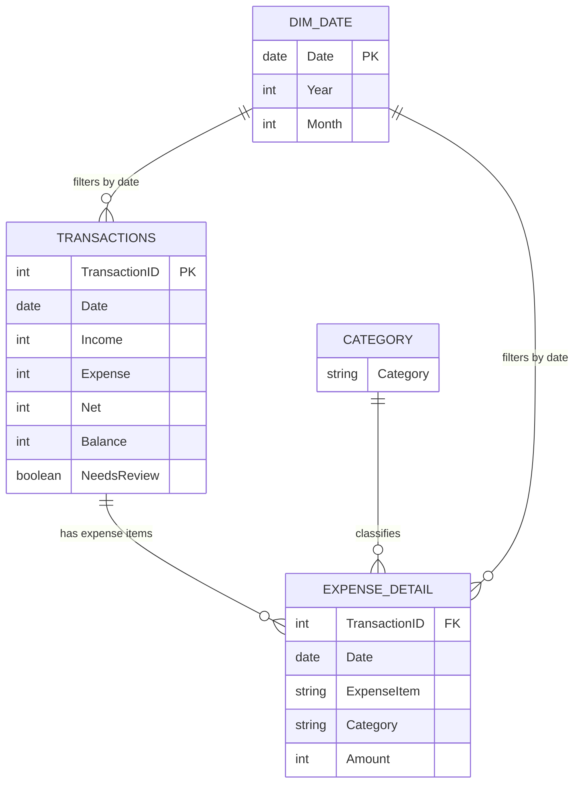

# ADF Business Financial Performance & Cash Flow Analysis
> *Analyzed business income, expenses, and transaction records to identify major cost drivers, investigate financial-data discrepancies, and build a Power BI reporting solution for better financial visibility and decision-making.*
---
## ⚙️ Project Type Flags
> 
- [x] Exploratory Data Analysis (EDA)
- [ ] SQL Analysis / Querying
- [x] Dashboard / Data Visualization
- [x] Data Pipeline / ETL
- [ ] Predictive Modelling / Machine Learning
- [x] Data Cleaning / Wrangling
- [x] End-to-End (multiple of the above)
---
## Table of Contents
1. [Project Overview](#1-project-overview)
2. [Objectives](#2-objectives)
3. [Project Scope & Tools](#3-project-scope--tools)
4. [Repository Structure](#4-repository-structure)
5. [Data Workflow](#5-data-workflow)
6. [Data Model & Schema](#6-data-model--schema)
7. [Analysis & Metrics](#8-analysis--metrics)
8. [Key Insights](#9-key-insights)
9. [Recommendations](#10-recommendations)
10. [Assumptions & Limitations](#11-assumptions--limitations)
11. [Future Enhancements](#12-future-enhancements)
12. [Deliverables](#13-deliverables)
13. [Author](#14-author)

---
## 1. Project Overview
**Context:** ADF maintains financial records documenting customer payments, business expenses, materials purchases, labour, utilities, and other operational transactions. The supplied workbook contains transaction summaries alongside itemized expense records, but the information requires structured analysis to provide a clearer view of business cash movements and spending patterns.

**Problem Statement:** How can ADF organize its financial records, identify its largest expense categories, monitor income and expenditure over time, and detect inconsistencies that could affect financial reporting and business decisions?

**Approach:** The project uses Microsoft Power BI and Power Query to prepare the financial data, examine data-quality issues, structure the transaction and expense-detail tables, and develop an interactive dashboard. Measures will be created to track recorded income, expenses, net cash movement, expense composition, and financial trends.

**Outcome:** The intended deliverable is an interactive Power BI reporting solution that provides visibility into recorded financial activity, highlights expense drivers, and identifies transactions requiring further verification. Final dashboard findings and recommendations will be documented after the calculations and source records have been validated.

### Initial Dataset Profile

| Measure | Initial value |
|---|---:|
| Transaction records | 24 |
| Expense-detail records | 87 |
| Recorded income | 817,000 |
| Recorded expenses | 712,050 |
| Net cash movement | 104,950 |
| Transactions flagged for review | 4 |
| Earliest transaction date | 7 October 2023 |
| Latest transaction date | 10 March 2026 |

*These are preliminary figures calculated from the supplied workbook.*

---

---
## 2. Objectives

- **Primary Objective:** Build an interactive Power BI dashboard that consolidates ADF's recorded income and expenses into a clear view of financial activity and net cash movement.

- **Secondary Objective 1:** Identify the largest expense categories and quantify their contributions to total recorded expenditure.

- **Secondary Objective 2:** Analyze income, expenses, and net cash movement across the available transaction dates to identify periods of higher or lower financial activity.

- **Secondary Objective 3:** Identify discrepancies, ambiguous entries, and incomplete transaction information that require verification before financial conclusions are drawn.

- **Secondary Objective 4:** Develop actionable recommendations for improving expense monitoring, transaction documentation, and financial reporting.

---
## 3. Project Scope & Tools

### Scope

| Dimension | Details |
|---|---|
| **In Scope** | Recorded income, business expenses, expense categories, transaction dates, descriptions, balances, and data-quality review notes |
| **Out of Scope** | Verified accounting profit, tax calculations, inventory valuation, receivables ageing, and audited financial statements, because the necessary supporting information is not established in the supplied workbook |
| **Time Period** | 7 October 2023 – 10 March 2026 |
| **Granularity** | Transaction-level summaries and itemized expense records |
| **Business Focus** | Financial monitoring, expense analysis, cash-flow visibility, and data-quality control |

### Tools & Technologies

| Category | Tool(s) Used |
|---|---|
| Data Storage | Microsoft Excel workbook |
| Data Processing | Power Query |
| Analysis | Power BI measures and exploratory analysis |
| Visualization | Microsoft Power BI |
| Version Control | Git and GitHub |
| Documentation | Markdown |
| Other | Data modelling and financial metric validation |

*This table describes the intended implementation. Update it to reflect the tools actually used when the project is complete.*

---

## 4. Repository Structure

```text
ADF-Financial-Performance-Analysis/
│
├── data/
│   ├── raw/
│   │   └── ADF_SALES_REPORT.xlsx
│   ├── processed/
│   │   └── README.md
│   └── external/
│
├── powerbi/
│   └── ADF_Financial_Analysis.pbix
│
├── queries/
│   └── README.md
│
├── reports/
│
├── visuals/
│   ├── executive_overview.png
│   ├── expense_analysis.png
│   └── cashflow_trends.png
│
├── docs/
│   ├── data_dictionary.md
│   ├── data_quality_log.md
│   └── methodology.md
│
└── README.md
```

---
## 5. Data Workflow

```text
Source Workbook
      |
      v
Power Query Ingestion
      |
      v
Data Profiling & Quality Checks
      |
      v
Cleaning & Transformation
      |
      v
Data Modelling
      |
      v
DAX Measures & Validation
      |
      v
Power BI Dashboard
      |
      v
Business Insights & Recommendations
```
### 1. Source

The source is `ADF SALES REPORT.xlsx`, containing three worksheets:

- `Transactions` — 24 transaction summaries and supporting notes.
- `Expense Detail` — 87 itemized expense records.
- `Category` — a reference list of expense categories.

### 2. Ingestion

Import the three worksheets into Power BI through **Home → Get Data → Excel Workbook → Transform Data**.

Assign clear query names and inspect the columns, data types, and relationships before loading the data model.

### 3. Cleaning

The cleaning process will include:

- Confirming that transaction IDs are valid and identifying duplicate records.
- Standardizing date, text, and numeric data types.
- Checking for missing values and inconsistent category names.
- Investigating transactions flagged through `NeedsReview`.
- Checking whether recorded net movement equals income minus expense.
- Comparing transaction-level expense totals with the itemized expense detail.
- Investigating ambiguous transfers, negative entries, and potentially incomplete descriptions.
- Preserving original values and documenting corrections rather than silently changing financial records.

### 4. Transformation

Planned transformations include:

- Creating a proper date dimension for time-based analysis.
- Structuring transaction summaries and expense details into a relational model.
- Standardizing expense categories.
- Creating calculated measures for income, expenses, net cash movement, and category contribution.
- Establishing a documented approach to transaction reconciliation.

### 5. Analysis

The analysis will cover:

- Income and expense trends over time.
- Expense composition by category.
- Monthly and annual financial activity where sufficient observations exist.
- Net cash movement by transaction and period.
- Transactions requiring review.
- Reconciliation between summary records and itemized expenses.

### 6. Output

The intended deliverables are a Power BI report, validated financial measures, a data-quality log, documented business findings, and actionable recommendations.

---
## 6. Data Model & Schema
The workbook contains two transaction-related tables and one category lookup table.

### Dataset / Table: `Transactions`

**Row count:** 24

| Field Name | Data Type | Description | Example |
|---|---|---|---|
| TransactionID | Whole number | Identifier for a transaction summary | 1 |
| Date | Date | Recorded transaction date | 2023-10-07 |
| Year | Whole number | Calendar year | 2023 |
| Month | Whole number | Calendar month number | 10 |
| Source | Text | Source or record group | ADF Sales |
| Description | Text | Summary of the transaction | Daily overhead |
| PreviousBalance | Decimal | Previously recorded balance, where available | 32,500 |
| Income | Whole number | Recorded income for the transaction | 68,500 |
| Expense | Whole number | Recorded expenditure for the transaction | 40,500 |
| Net | Whole number | Recorded income minus expense | 28,000 |
| Balance | Whole number | Recorded balance field | 28,000 |
| NeedsReview | Boolean | Indicates whether the transaction requires review | FALSE |
| ReviewNote | Text | Explanation of an identified issue | Amount requires confirmation |
| Notes | Text | Additional transaction details | Expense breakdown |

### Dataset / Table: `Expense Detail`

**Row count:** 87

| Field Name | Data Type | Description | Example |
|---|---|---|---|
| TransactionID | Whole number | Links the expense record to a transaction | 1 |
| Date | Date | Date associated with the expense | 2023-10-07 |
| Year | Whole number | Calendar year | 2023 |
| Month | Whole number | Calendar month number | 10 |
| Source | Text | Source or record group | ADF Sales |
| Transaction | Text | Transaction description or grouping | Daily overhead |
| ExpenseItem | Text | Individual expense item | Salaries |
| Category | Text | Expense classification | Salaries |
| Amount | Whole number | Recorded expense amount | 13,000 |

### Dataset / Table: `Category`

**Row count:** 16

| Field Name | Data Type | Description | Example |
|---|---|---|---|
| Category | Text | Expense category reference | Gas / Fuel |

### Proposed Data Model

A practical starting point is a transaction-summary table linked to its expense-detail records by `TransactionID`.



**Important modelling considerations:**

- `Transactions[TransactionID]` should be unique before it is used as the one-side of a relationship.
- `Expense Detail[TransactionID]` may repeat because one transaction can contain several expense items.
- The category lookup should have unique category values before being related to the expense-detail table.
- A shared date dimension can filter both transaction summaries and expense details.
- Avoid directly summing transaction-level expenses and itemized expenses together: they represent different levels of detail and could double-count expenditure.
- The model must be validated against the actual Power BI relationships before the diagram is considered final.

---

## 7. Analysis & Metrics

### Analytical Approach

This is an exploratory financial-analysis project focused on descriptive analysis, expense segmentation, cash-flow monitoring, and data-quality investigation.

The analysis begins by establishing reliable definitions for the financial measures. It then examines patterns across transaction dates and expense categories, while investigating whether inconsistencies in the source records could affect the interpretation of results.

The project does not assume that recorded net cash movement is equivalent to accounting profit. Customer deposits, payments to third parties, transfers, personal expenses, and incomplete transaction information may require different accounting treatment.

### Key Metrics Defined

| Metric | Plain-Language Definition | Why It Matters |
|---|---|---|
| Total Recorded Income | Sum of the income amounts recorded in the transaction table | Establishes the volume of recorded incoming funds |
| Total Recorded Expenses | Sum of the expense amounts recorded in the transaction table | Measures recorded expenditure |
| Net Cash Movement | Total recorded income minus total recorded expenses | Shows the net movement implied by the recorded transactions |
| Expense Category Share | Expense amount for a category divided by total recorded expenses | Identifies the largest spending categories |
| Average Transaction Income | Total recorded income divided by the number of transactions with income | Provides a basic measure of income per income-generating transaction |
| Expense-to-Income Ratio | Recorded expenses divided by recorded income | Shows expenditure relative to recorded incoming funds |
| Transactions Requiring Review | Count of transactions flagged for further verification | Helps prioritize data-quality investigation |
| Monthly Income | Total recorded income grouped by calendar month | Tracks the timing of incoming funds |
| Monthly Expenses | Total recorded expenses grouped by calendar month | Tracks changes in spending over time |

*All metrics must be implemented and validated in Power BI before they are reported as final dashboard outputs.*

### Methods Used

- Descriptive analysis of financial totals.
- Time-series analysis across the available dates.
- Expense-category segmentation.
- Reconciliation of transaction summaries with expense-detail records.
- Data-quality profiling and anomaly investigation.
- Comparative analysis of income, expenses, and net cash movement.
- Interactive filtering by date, category, and source.

---

## 8. Key Insights

The following are preliminary observations from the supplied workbook. They should be treated as initial findings rather than final business conclusions.

**Insight 1: Recorded income exceeds recorded expenditure in aggregate**

The workbook contains 817,000 in recorded income and 712,050 in recorded expenses, producing a net cash movement of 104,950. This establishes a positive aggregate difference in the recorded figures, but it does not prove that the business generated 104,950 in accounting profit.

**Insight 2: Materials are the largest recorded expense category**

The itemized expense records attribute 227,350 to Materials, making it the largest category by recorded amount. This suggests that monitoring materials purchases may be important for understanding spending patterns. The underlying entries should still be reconciled with transaction summaries.

**Insight 3: Gas and fuel represent another substantial expense category**

Gas / Fuel totals 134,300 in the expense-detail table. This makes fuel and generator-related spending another useful area to investigate for expense monitoring and operational planning.

**Insight 4: Some transactions require additional verification**

Four transaction summaries are flagged for review. Their notes include uncertainty around a customer receipt, unpriced materials, and ambiguous transfer or payment entries. These issues could affect the reliability of the recorded totals and should be resolved before making firm financial decisions.

**Insight 5: The available records are unevenly distributed over time**

The workbook contains records from October 2023, July–December 2025, and March 2026, with substantial gaps between these periods. Month-to-month and year-over-year comparisons may therefore be incomplete or misleading.

---

## 9. Recommendations

| Priority | Recommendation | Based On | Suggested Owner |
|---|---|---|---|
| High | Resolve the four flagged transactions by verifying receipts, material costs, and ambiguous payment directions against source records. | Insight 4 | Business owner / Finance |
| High | Reconcile transaction summaries with itemized expense records and document any differences before publishing final totals. | Insights 1 and 4 | Finance / Data Analyst |
| High | Establish a consistent recordkeeping template that captures transaction date, transaction ID, income, expense, category, payment direction, and supporting notes. | Insights 4 and 5 | Business owner / Operations |
| Medium | Monitor materials spending by category and transaction to identify recurring high-cost purchases and opportunities for better purchasing control. | Insight 2 | Procurement / Operations |
| Medium | Track gas and fuel expenses separately and review recurring consumption-related spending. | Insight 3 | Operations |
| Medium | Use a monthly financial dashboard to monitor income, expenditure, and net cash movement consistently as new records become available. | Insights 1 and 5 | Business owner / Finance |
| Low | Expand the dataset with customer-level payment status, order costs, outstanding balances, and transaction classifications where appropriate. | Insights 4 and 5 | Business owner / Data Analyst |

---

## 10. Assumptions & Limitations

### Assumptions

- The `Income`, `Expense`, and `Net` fields represent the values recorded in the source workbook; their underlying accounting treatment has not been independently verified.
- The `TransactionID` field is intended to identify a transaction summary and is expected to link to related expense-detail records.
- The expense categories are intended to classify itemized spending, but category definitions may require standardization.
- Transaction dates represent the dates associated with the recorded financial activity.
- Net cash movement is interpreted as recorded income minus recorded expenses, not as verified accounting profit.

### Limitations

- The dataset is small, with 24 transaction summaries and 87 expense-detail records.
- The date range is discontinuous, so trend comparisons may not represent complete monthly or annual business performance.
- The currency is not explicitly identified in the supplied workbook.
- Four transactions have unresolved review flags.
- Some notes identify unpriced materials or ambiguous payment/transfer entries.
- The available fields do not establish a complete inventory, cost-of-goods-sold, tax, accounts-receivable, or audited accounting model.
- Customer-level and product-level profitability cannot be established reliably from the current summary structure alone.
- The recorded net movement may be affected by deposits, transfers, repayments, personal expenses, and other transactions that require appropriate classification.
- The analysis cannot independently verify whether all business transactions have been recorded.

---

## 11. Future Enhancements

- [ ] Expand the transaction history to cover all available months and reconcile the records against source documents.
- [ ] Add transaction classifications to distinguish customer receipts, deposits, supplier payments, transfers, reimbursements, and personal expenses.
- [ ] Develop a standardized expense-category hierarchy and data-entry validation rules.
- [ ] Add order-level revenue and direct-cost data to support more reliable product profitability analysis.
- [ ] Introduce a reconciliation report that flags differences between summary expenses and itemized expense details.
- [ ] Automate the refresh process when new financial records are added to a structured source file.

---

## 12. Deliverables

| Deliverable | Description | Location |
|---|---|---|
| Power BI Report | Interactive financial overview and expense-analysis dashboard | `powerbi/ADF_Financial_Analysis.pbix` |
| Project README | Business problem, methodology, findings, and recommendations | `README.md` |
| Data Dictionary | Field definitions and table descriptions | `docs/data_dictionary.md` |
| Data Quality Log | Identified discrepancies, review decisions, and reconciliation notes | `docs/data_quality_log.md` |
| Dashboard Screenshots | Exported report pages for portfolio presentation | `visuals/` |
| Methodology Notes | Documented transformation and metric definitions | `docs/methodology.md` |
---

## 13. Author

**ALEX ESIVBEKPE**
**Business Data & AI Automation Analyst**

Interested in transforming complex or disorganized information into structured, reliable analysis that helps businesses identify inefficiencies, understand performance, and make better-informed decisions.

- 🔗 LinkedIn: www.linkedin.com/in/alex-esivbekpe
- 💼 GitHub: https://github.com/alexdanalyst/alexdanalyst
- 🌐 Portfolio: https://alexdanalyst.github.io

---


